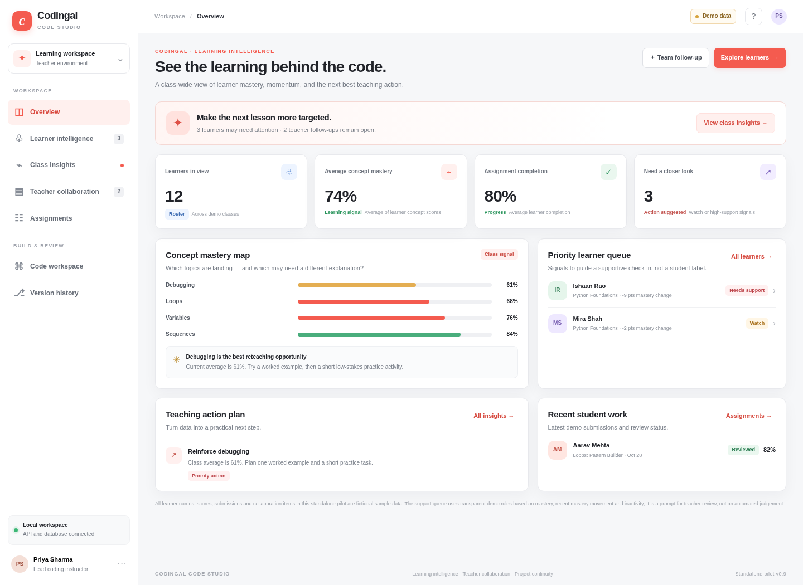

# Codingal Code Studio — Learning Intelligence & Teacher Collaboration



A locally runnable standalone pilot focused on **actionable learner performance, teacher collaboration, assignments, project continuity, and coding**. The pilot uses a real SQLite database and local Git repositories. It is not connected to Codingal's production systems.

## Product capabilities

- Teacher overview: class-level learning indicators, concept mastery, learners needing a closer look, suggested teaching actions, and recent submissions.
- Learner intelligence: search and filter learners; view concept profiles, completion, mastery movement, recent assignment results, and existing follow-ups.
- Class insights: surface areas for reteaching and review mastery movement with explainable, rule-based signals.
- Teacher collaboration: create and assign follow-ups, set priority and target dates, keep discussion comments, and track open / in-progress / resolved status.
- Assignments: create tasks, record due dates and learning objectives, monitor seeded submission summaries, archive or reopen assignments.
- Code workspace: create projects, save files, switch starter languages, run HTML in a sandboxed iframe, and run Python/Java/C++ through an isolated local Docker container when configured.
- Git version history: real local Git repositories, named commits, history listing, and a restore operation that records a new commit rather than wiping later history.
- Persistence: SQLite by default. The data folder and Git repositories remain on the host machine between restarts.
- Learner overview export: export the current learner table as CSV.

## Requirements

- Python 3.10 or newer (Python 3.11/3.12 recommended).
- Git installed and available on `PATH`.
- Modern Chrome, Edge, Firefox, or Safari.
- Docker Desktop/Engine is optional for code execution. The dashboard and product workflows work without Docker; native Python/Java/C++ execution stays disabled until the local runner image is built.

## Run locally on macOS / Linux

1. Extract the ZIP to a folder you control.
2. Open Terminal and `cd` into `codingal_code_studio`.
3. Run:

   ```bash
   ./run.sh
   ```

4. Open `http://127.0.0.1:8000`.
5. API documentation is available at `http://127.0.0.1:8000/docs`.

The first run installs Python dependencies in `.venv` and seeds **fictional sample data** into `data/codingal_studio.db`. To reset the sample database, stop the app and delete `data/codingal_studio.db` plus the `data/repos/` folder, then restart it.

## Run locally on Windows

Double-click `run.bat`, or open Command Prompt in the project folder and run `run.bat`. Then visit `http://127.0.0.1:8000`.

## Enable isolated local Python / Java / C++ execution

Docker is optional. If Docker Desktop/Engine is installed and running, build the supplied local runner image **from the project directory**:

```bash
docker build -t codingal-runner:local -f runner/Dockerfile runner
```

Restart the app if needed. The API launches a short-lived container per run with controls including `--network=none`, a read-only root filesystem, dropped Linux capabilities, a non-root user, memory/CPU/process limits, a timeout, and an input directory mounted read-only. If Docker or the image is unavailable, the app states that no code was executed.

**Security caveat:** This is a development/pilot isolation baseline, not a certified multi-tenant sandbox. Do not expose the API publicly or use it for untrusted public workloads. A production service should isolate the runner plane from the app/database plane, harden container/VM policies, apply egress policies, implement authenticated quotas, conduct escape testing, and use an appropriate microVM or hardened sandbox architecture.

HTML/CSS/JavaScript is previewed in a browser iframe with `sandbox="allow-scripts"`; it is not uploaded to a remote renderer.

## Environment configuration

Copy `.env.example` to `.env` for your own notes, then export variables in your shell or use your preferred environment loader. Defaults:

- `HOST=127.0.0.1` (local-only)
- `PORT=8000`
- `CODESTUDIO_DATA_DIR=<project>/data`
- `CODESTUDIO_RUNNER_IMAGE=codingal-runner:local`
- `DATABASE_URL` may be set to a PostgreSQL URL for a staging build; the pilot has been designed and seeded for local SQLite.

The current app does not automatically load `.env`; export environment variables in your terminal or extend the app with an explicit dotenv loader before relying on this file.

## API surface

FastAPI/OpenAPI docs are available at `/docs`. Key routes:

- `GET /api/health`, `GET /api/overview`
- `GET /api/students`, `GET /api/students/{id}`
- `GET/POST /api/assignments`, `PATCH /api/assignments/{id}`
- `GET/POST /api/notes`, `PATCH /api/notes/{id}`, `POST /api/notes/{id}/comments`
- `GET/POST /api/projects`
- `GET /api/projects/{id}/files`, `GET/PUT /api/projects/{id}/files/{filename}`
- `POST /api/projects/{id}/commit`, `GET /api/projects/{id}/versions`, `POST /api/projects/{id}/restore`
- `POST /api/runs`, `GET /api/runs`

## Architecture decisions

- **Frontend:** HTML/CSS/JavaScript for a no-build, easy-to-inspect standalone pilot.
- **API:** Python + FastAPI + Pydantic validation.
- **Application database:** SQLAlchemy ORM; SQLite default for local setup.
- **Source history:** real Git CLI repositories under `data/repos/`; command arguments are constructed server-side rather than accepting arbitrary Git commands from the browser.
- **Execution:** optional Docker runner with language runtimes, resource limits, timeout, and disabled container networking.
- **Analytics:** rule-based, explainable sample signals from concept scores, mastery movement, completion and inactivity. The sample signals are not validated for high-stakes decisions.

## Important gaps before a real Codingal pilot

This package is a strong standalone pilot, not a production-ready enterprise deployment. It has no production authentication, SSO, tenant isolation, live Codingal roster/classroom integration, shared cross-user session model, centralised Git service, production-grade runner orchestration, persistent analytics event pipeline, or compliance review. Several teacher identities are present as fictional demo values; they are not authenticated collaborators between machines. Local deployment is bound to `127.0.0.1` by default.

Before a CEO demo using real records or a production release, implement and verify at minimum:

1. Codingal-approved identity integration (OIDC/OAuth), server-side sessions, CSRF defence where applicable, roles, class-scoped authorisation, and audit logs.
2. Data governance: purpose limitation, retention/deletion policies, age-appropriate privacy review, consent/notice requirements, and access logs for student code and analytics.
3. Production database migrations, PostgreSQL backup/restore drills, object storage policy, secrets management, and deployment IaC.
4. A separately deployed execution service with per-run isolation, quotas, job deduplication, egress restrictions, abuse monitoring, and sandbox escape assessment.
5. Validated learning rubrics and reliable event ingestion so metrics represent actual learning evidence rather than sample scores or raw keystrokes.
6. Automated tests, accessibility testing, threat modelling, load tests, monitoring, alerting, incident response, and documented recovery objectives.

## License / data notice

The implementation in this package is an original prototype for evaluation. All names, scores, assignments, submissions, and teacher collaboration items seeded by the app are **fictional demonstration data**. Replace them only through an authorised, privacy-reviewed integration.
# projectxcv
# projectxcv
# projectxcv
